<div align="center">



# Gabriel Rance

**AI engineer who deploys LLM systems inside real companies.**
I sit with the customer, find the workflow worth automating, and ship the agent, the integrations and the evals behind it.

**OpenAI Codex Hackathon finalist** · ENSAM engineer · ex construction-site manager

[LinkedIn](https://linkedin.com/in/gabriel-rance-ensam) ·
[Email](mailto:gabriel.rance@ensam.eu) ·
[Portfolio](https://iamgabriel.xyz)

</div>

---

| **Finalist** | **600k+** | **2,000+** | **10+** |
|:---:|:---:|:---:|:---:|
| OpenAI Codex Hackathon | production queries behind my LLM routing work | users on the agent platform I build at Wonka AI | MCP servers built for customer stacks |

## Flagship work

### [Fredo / Bond-OpenAI](https://github.com/Caezarr/Bond-OpenAI) · OpenAI Codex Hackathon finalist

**Give a coding agent a safe, real-world action: placing a phone call.**

One Codex prompt becomes a real, consented outbound call, and the structured result returns to the same task.
The interesting part is the action contract, not the demo: classify, clarify, preview, explicit confirmation,
verified caller ID, strict destination allowlist, 180-second cap, idempotency keys.

`MCP` · `Codex plugin` · `Twilio` · `Deepgram Voice Agent` · `Python`

### [QueryRouter++](https://github.com/Caezarr/queryrouter-plus-plus) · LLM routing research

**Pick the right model per query instead of one default model for everything.**

Formal compatibility score `C(q, m, w) = Σ wᵢ · Aᵢ(q, m)` across performance, cost, latency and CO₂,
with user preferences as weights on a simplex. Weights shift toward performance when tools are active
(web search, code exec, MCP). Started as my ENSAM thesis on 86k production queries, now **600k+**.

`Python` · `FastAPI` · `LLM evaluation` · `multi-objective optimization`

### [Orbis](https://github.com/Caezarr/orbis) · agent harness

**A harness that makes a business task safe to hand to an agent: declared, tested, gated, replayable.**

Each capability is a versioned contract, not a prompt:

```yaml
role: quote_preparer
objective: produce_reviewable_quote
context: [company_profile, approved_catalog, customer_request]
tools: [read_docs, calculate, draft_document]
must: [cite_sources, expose_assumptions, use_integer_money_math]
cannot: [send_email, change_price_catalog]
```

Around it: eval datasets and quality gates before activation, tenant- and ACL-scoped retrieval,
memory that only changes with human approval, idempotent external actions, budget reserved per run,
red-team tests. Questions it is built to answer: *why did the agent produce this, can we replay it,
can we swap the model provider without rewriting the capability?*

`TypeScript` · `evals` · `agent memory` · `scoped retrieval` · `red-teaming`

### [Kanten](https://kanten.io) · live product

**Content intelligence for creators: what is working in your niche, turned into a script you can shoot.**

Tracks creators, flags posts that outperform their author's median, analyses hooks and structure,
then writes scripts in the user's own style. Ships with its own MCP server, so the whole product
is drivable from Claude.

`TypeScript` · `Next.js` · `MCP` · `video analysis` · `LLM pipelines`

## Forward-deployed at Wonka AI

Wonka builds AI agents for European SMBs. I'm Country Manager for France and I still write the code:
I run the customer from first call to production deployment, so the gap between a model and a
customer's systems is my job end to end.

- **Integrations into customer stacks.** MCP servers for accounting and ERP APIs (OAuth2, 75-endpoint catalog generated from the API spec), CRM, Microsoft 365 via Graph, on-prem systems over NTLM.
- **Model platform.** Multi-provider routing across OpenAI, Anthropic, Mistral and Google, under zero-data-retention and no-training constraints.
- **Customer deployments.** Support-ticket routing for an energy provider built from 68k historical tickets (mined rules + LLM, running in production); email triage and ERP automation for industrial and service companies.
- **Product.** In-chat agent builder, connector OAuth flows, usage analytics and billing, shaped by what customers hit in the field.

`TypeScript` · `Python` · `MCP` · `OAuth` · `n8n` · `Azure DevOps`

## Agent tooling

| Project | What it does |
|---|---|
| **[Gauntlet](https://github.com/Caezarr/gauntlet)** | Parallel agent harness on Claude Code: QA, review and security audits with evidence (logs, HTTP bodies, traces) and a validator gate before any fix lands. |
| **[wonka-audit](https://github.com/Caezarr/wonka-audit)** | `npx` CLI that measures how teams actually use Claude Code, Codex and Cursor, local-first and privacy-safe. Used before and after AI enablement workshops. |
| **[Bowimi MCP](https://github.com/Caezarr/bowimi-mcp)** | MCP server connecting Claude to a field-sales CRM: routes, locations, contacts, orders. |
| **agent-secrets** | Moves plaintext secrets out of Codex, Claude Code, Claude Desktop and Cursor configs into the macOS Keychain. |
| **[Vulcan](https://github.com/Caezarr/Vulcan)** | Agents, skills and templates to go from spec to shipped feature. |

## Why I work this way

Before software I spent ten years on construction sites, from Compagnons du Devoir apprentice to running
projects above €10M. That is where I learned the FDE job: understand how the work is really done,
earn the trust of the people doing it, then ship something they actually use.

- I start from the workflow and the data, not the model.
- I ship evals and guardrails with the feature, not after.
- I prefer a small V1 in production over a large demo.
